<div align="center">

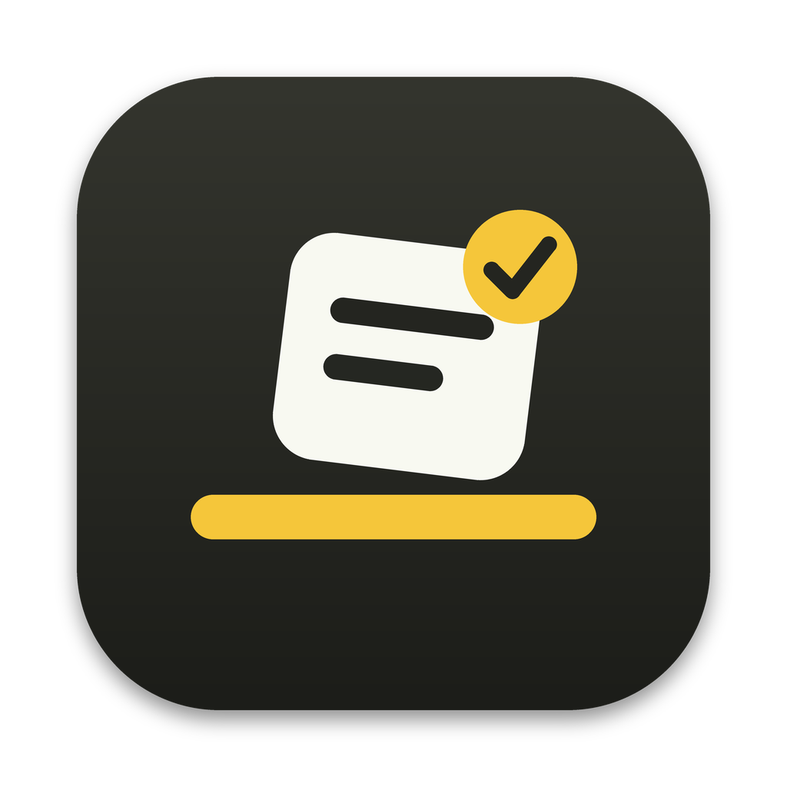

# Drag Shelf for Windows and macOS

**A temporary shelf for the files, links, text and images you're moving around.**
Start dragging, shake the mouse, drop it on the shelf, grab it again when you need it.

Windows x64 · Apple Silicon · Intel · Universal &nbsp;|&nbsp; MIT licensed

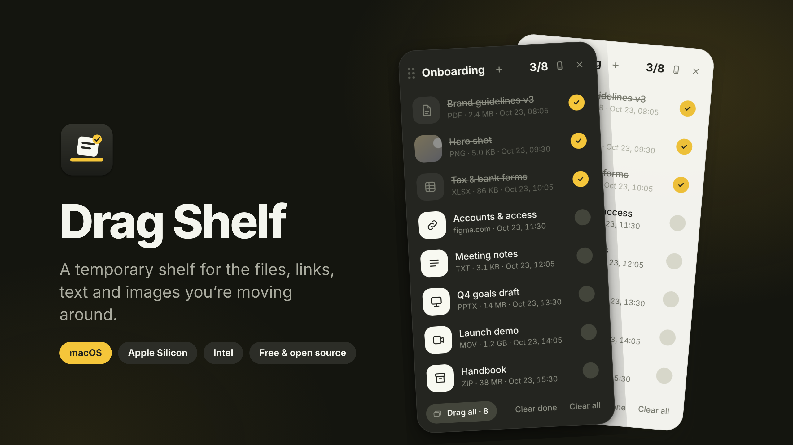

</div>

---

## Download

Grab the build for your computer from the **[Releases](../../releases)** page.

**Windows 10/11 (x64):** download `DragShelf-<version>-windows-x64-setup.exe` to install, or `DragShelf-<version>-windows-x64-portable.exe` to run without installation. Version 1.1 brings the same interface as macOS: rich file rows, completion ticks, confetti, eight accents, multiple shelves, phone transfers and the animated guide. The default shortcut is **Ctrl+Shift+F**. Existing shelves from the old native Windows app are imported once; the original data is retained.

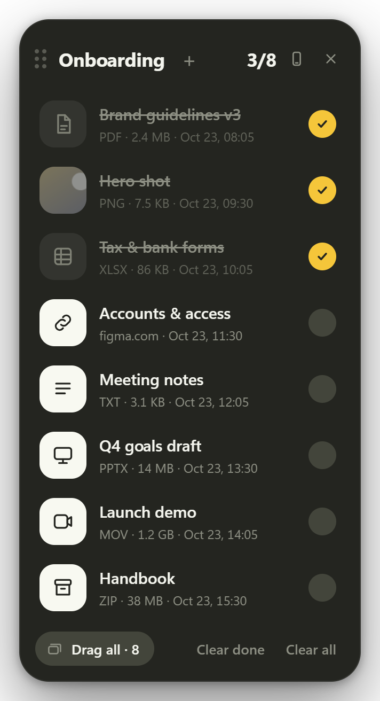 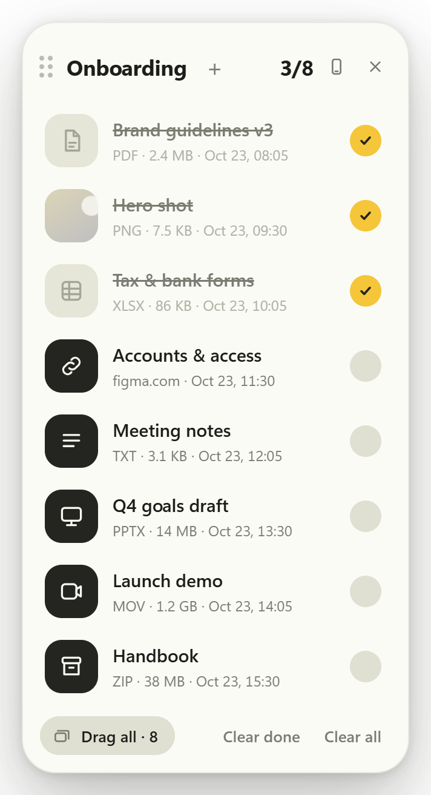

**macOS:** choose the build for your Mac:

| Mac | File |
|---|---|
| Apple Silicon (M1 / M2 / M3 / M4 …) | `DragShelf-<version>-mac-arm64.dmg` |
| Intel | `DragShelf-<version>-mac-x64.dmg` |
| Either (one bigger file) | `DragShelf-<version>-mac-universal.dmg` |

`.zip` versions of each are attached too. Open the DMG and drag **Drag Shelf** into *Applications*.

### First launch (unsigned builds)

Builds from this repo are *ad-hoc signed*, not notarized by Apple (that needs a paid developer account – see [Signing](#signing--notarization)). macOS will therefore say the app can't be verified the first time:

1. Right-click **Drag Shelf** in *Applications* → **Open** → **Open**, **or**
2. run `xattr -dr com.apple.quarantine "/Applications/Drag Shelf.app"` once in Terminal.

### Permission it asks for

To notice that you are *dragging something and shaking the mouse*, Drag Shelf needs **Accessibility** access
(*System Settings → Privacy & Security → Accessibility → Drag Shelf*). It only watches mouse movement; it never records keystrokes or screen contents, and nothing leaves your Mac. Without the permission the shelf still works from the menu bar icon and the keyboard shortcut. Drag detection switches on by itself a couple of seconds after you grant access – no restart needed.

---

## How it works

<div align="center">
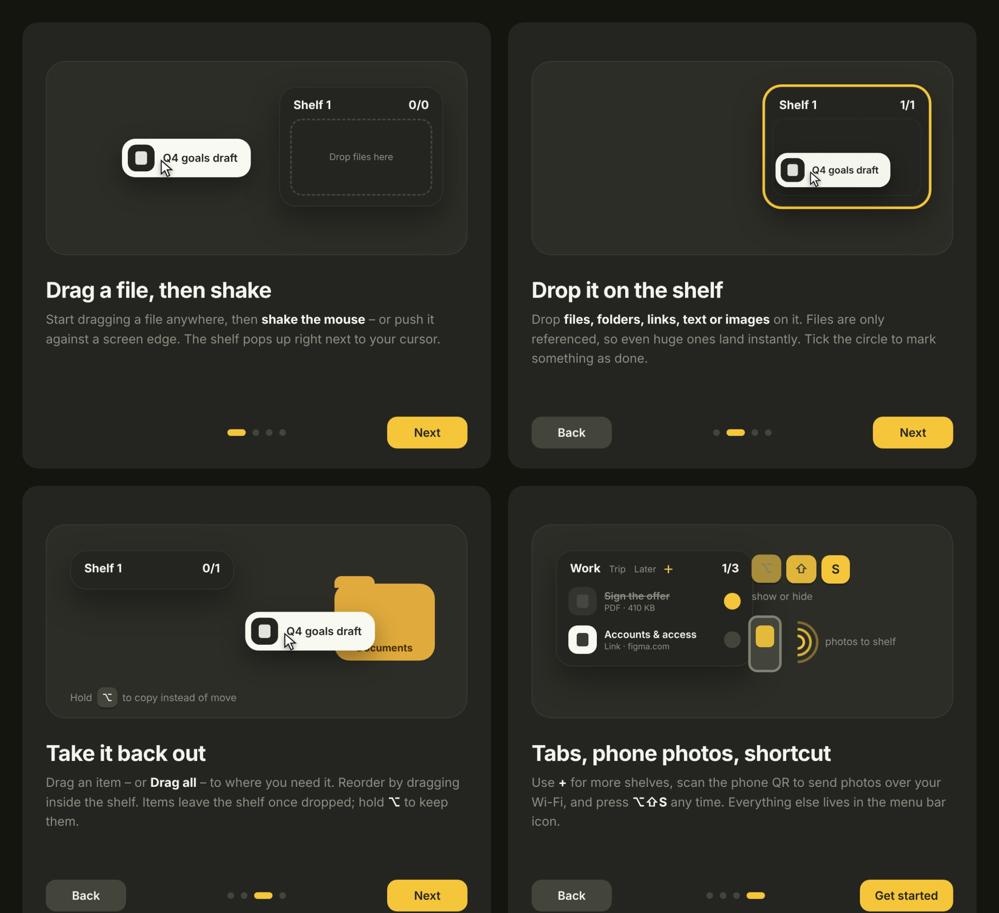
</div>

1. **Drag a file, then shake.** Pick up a file anywhere, shake the mouse (three quick direction changes) or push it against a screen edge. The shelf appears next to your cursor.
2. **Drop it on the shelf.** Files, folders, links, text and images. Files are only *referenced*, so a 5 GB video lands instantly.
3. **Take it back out.** Drag one item – or **Drag all** – into any app or folder. Reorder by dragging inside the shelf.
4. **Tick it off.** The circle marks an item as done (strike-through + a little confetti). The counter shows *done / total*.

## Features

| | |
|---|---|
| **Shake / edge trigger** | Pops up only while you really drag something (the system drag pasteboard is checked – dragging a window or selecting text won't trigger it). *Strict drag detection* can be turned off. |
| **Everything droppable** | Files & folders (by reference), links (saved as `.webloc`), text (saved as `.txt`), images from browsers, files from zip/mail viewers. |
| **Drag out as real files** | Native file drag with the proper pasteboard, so Finder, Mail, Slack, browsers … all accept it. Items leave the shelf after a drop elsewhere – hold **⌥** to copy instead, or turn that off in the menu. |
| **Multiple shelves** | `+` adds a shelf. Hover a tab for ½ s while dragging to switch, drop on a tab to move items there, drop on `+` to start a new shelf. Double-click a tab to rename, right-click for *Rename / Clear / Delete*. |
| **Done / not done** | Tick circle, strike-through, `done/total` counter, **Clear done**, **Clear all**. |
| **Rich rows** | Quick Look thumbnails for images, PDFs and videos; type, size and the time it was added for everything; missing files are flagged. |
| **Row actions** | Double-click to open · right-click → *Open, Show in Finder, Copy path, Mark done, Remove*. |
| **Photos from phone** | Menu → *Photos from phone…* shows a QR code. Scan it, pick photos, they arrive on the shelf over your Wi-Fi (local network only, random secret URL, 400 MB per file). |
| **Global shortcut** | Default **⌥⇧S** shows/hides the shelf. Record your own in the menu. |
| **Menu bar app** | No Dock icon. Click the icon to show the shelf, right-click for the menu. |
| **Themes** | *Match macOS*, Light, Dark + 8 accent colours. |
| **Per-app exclusions** | *Never show over <app>* and an editable list, e.g. for games and presentation software. |
| **Start at login** | One tick in the menu. |
| **Private** | No network access except the optional phone transfer, no analytics, no accounts. |

### Screenshots

All pictures are captured from the real running app by `npm run screenshots`.

| | |
|---|---|
| <br>**Dark** | 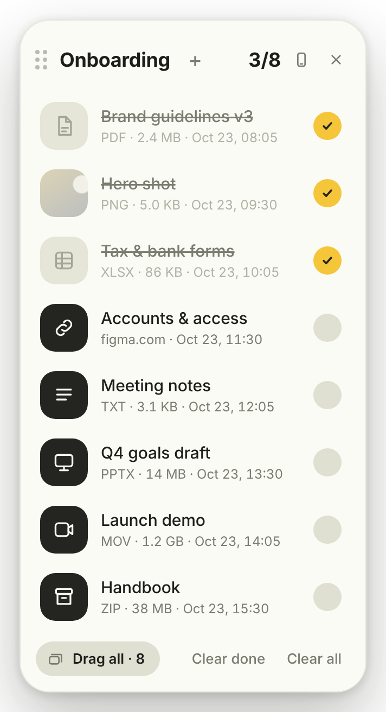<br>**Light** |
| 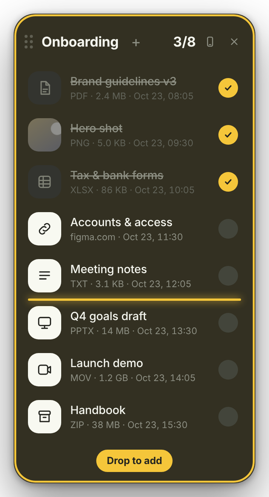<br>**Drop to add** – ring + insertion line | 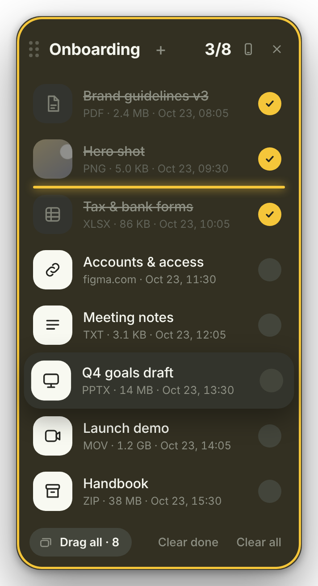<br>**Reorder / drag out** – lifted row |
| 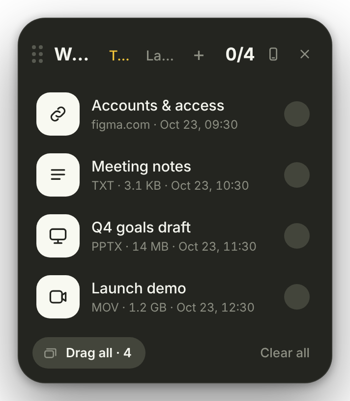<br>**Several shelves** | 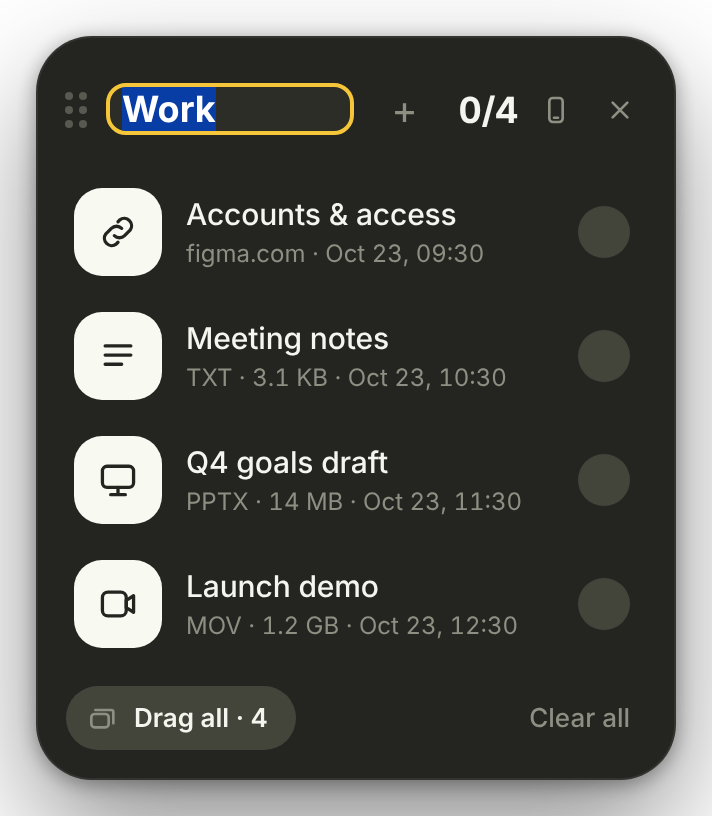<br>**Rename a tab** (double-click) |
| 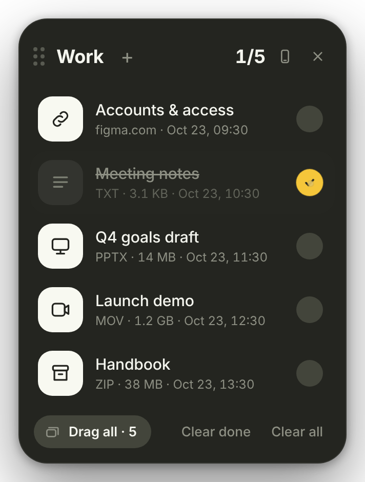<br>**Tick it off** | 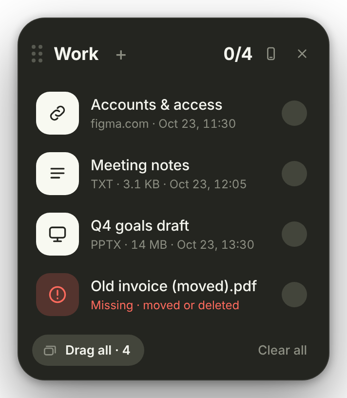<br>**Missing file** is flagged |
| 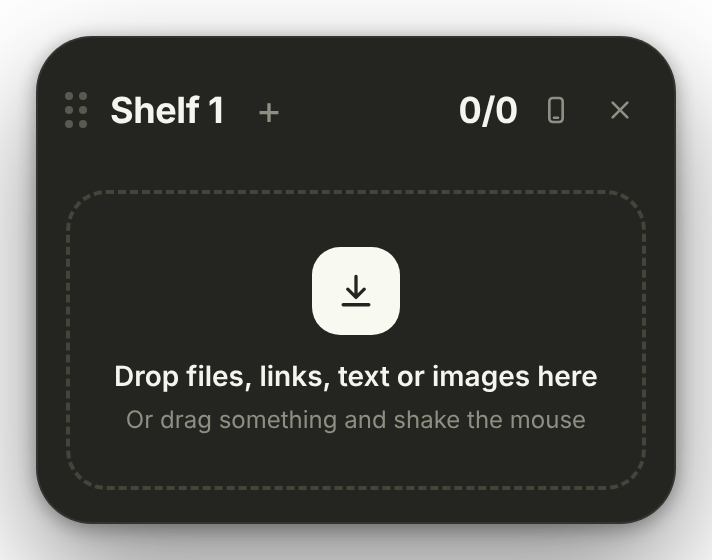<br>**Empty shelf** | 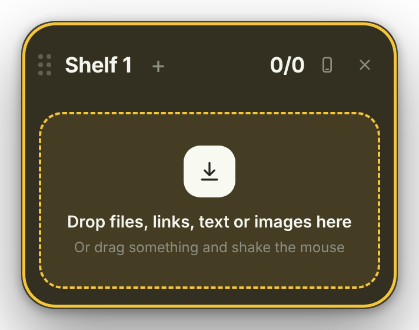<br>**Empty + drop target** |

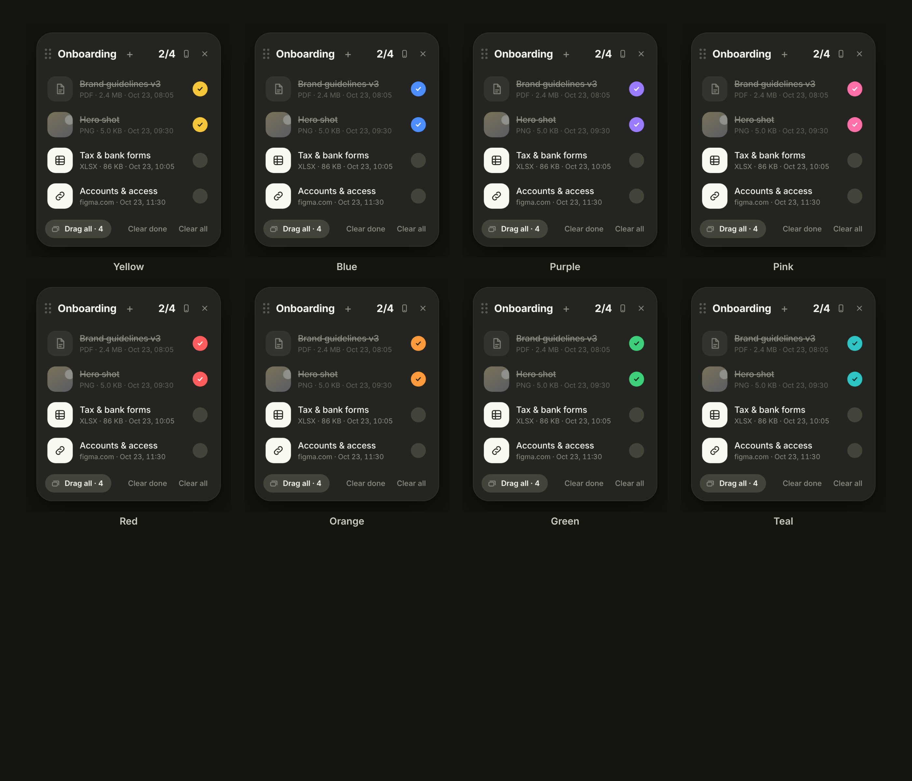

| 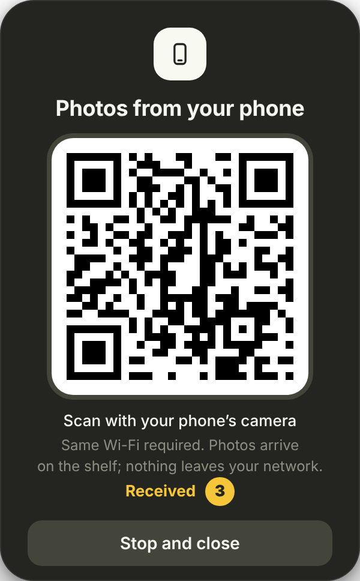<br>**Photos from phone** | 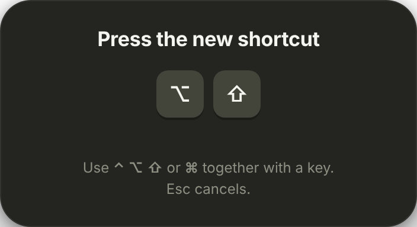<br>**Record a shortcut** | 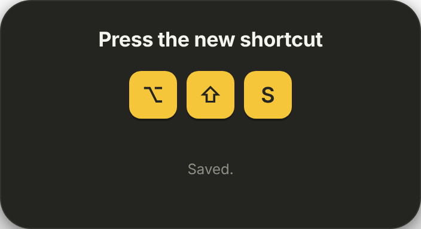<br>**Saved** |
|---|---|---|

### The menu bar menu

Left-click the icon = show/hide the shelf. Right-click:

```
Show shelf / Hide shelf
Photos from phone…
────────────────────────
Theme  ▸  Match macOS · Light · Dark
Accent color  ▸  Yellow · Blue · Purple · Pink · Red · Orange · Green · Teal
Change shortcut…
────────────────────────
Clear all shelves
Remove items after dragging them out
Strict drag detection
Start at login
Never show over <last app>
Edit excluded apps…
────────────────────────
Enable drag detection…      (opens the Accessibility pane)
Show guide
About Drag Shelf
Quit Drag Shelf
```

---

## Build it yourself

### Microsoft Store package

The Microsoft Store draft and MSIX workflow currently use the older native Windows app. Store submission is on hold; the improved Electron Windows interface is distributed through the GitHub installer and portable downloads. See [Microsoft Store submission](windows/store/SUBMISSION.md) for the earlier draft materials.

Requirements: Node 20+ and macOS or Windows. On Windows, building requires an x64 Visual Studio Developer Command Prompt for the small desktop-context helper:

```cmd
npm ci
cl /nologo /std:c++17 /EHsc /O2 /MT /DNOMINMAX windows\desktop-helper.cpp /Fe:build\win-helper.exe /Fo:build\win-helper.obj /link user32.lib shell32.lib
npm start
npm run dist:win
```

On macOS:

```bash
git clone https://github.com/im4tta/dragshelf.git && cd dragshelf
npm install
npm start                # run from source

npm run dist             # → dist/DragShelf-<v>-mac-x64.dmg  and  …-mac-arm64.dmg
npm run dist:universal   # → dist/DragShelf-<v>-mac-universal.dmg
```

`npm run dist` works on any Mac (Intel or Apple Silicon) for both architectures – the only native module, `uiohook-napi`, ships prebuilt binaries for `darwin-x64` and `darwin-arm64`.

### GitHub Actions

`.github/workflows/build.yml` runs the self-test on Linux and Windows, tests the packaged Windows app, builds **Windows x64 installer and portable EXEs**, and builds **x64, arm64 and universal** DMG/ZIPs on macOS. Windows screenshots are captured from the running app. Both platform builds must succeed before their files are attached to one release. Push a tag to publish a release:

```bash
git tag v1.0.0 && git push origin v1.0.0
```

### Signing & notarization

Without secrets the workflow ad-hoc signs (see *First launch*). To ship a build that opens with no warning, add these repository secrets and the same workflow signs **and notarizes** automatically:

`CSC_LINK` (base64 `.p12` Developer ID Application certificate) · `CSC_KEY_PASSWORD` · `APPLE_ID` · `APPLE_APP_SPECIFIC_PASSWORD` · `APPLE_TEAM_ID`

### Tests & screenshots

```bash
npm test                 # 39 end-to-end checks that drive the real app
npm run screenshots      # regenerate docs/screenshots from the real app
# on Linux prefix with:  xvfb-run -a -s "-screen 0 3600x2400x24"
```

The tests cover drops (file blobs, links, text), ticking, tabs, move/reorder, missing files, themes/accents, the phone upload server (secret-URL check, upload, shutdown), the shortcut recorder, the guide and persistence across restarts.

## Project layout

```
src/main/        main process: windows, menu bar, hotkey, IPC (main.js)
                 store.js (shelves + settings) · meta.js (kinds, sizes, thumbnails)
                 stash.js (links/text/images → real files) · phone.js (LAN upload server + QR)
                 dragwatch.js (global mouse hook: shake / edge + drag-pasteboard check)
src/preload/     the small, whitelisted bridge to the UI
src/renderer/    shelf, guide, phone and shortcut windows (plain HTML/CSS/JS)
build/           app icon (.icns/.png), menu bar template icons, entitlements
scripts/         icon generator, demo data, self-test, screenshot generator
windows/         small Windows desktop-context helper; legacy C++ app and Store draft
```

User data lives in `~/Library/Application Support/Drag Shelf/` (`shelves.json`, `settings.json`, `excluded.txt`, `stash/`).

## Platform conventions

Windows and macOS now share the same Electron UI and features. Platform conventions remain familiar:

| Windows | macOS |
|---|---|
| Tray icon | Menu bar icon (template image, adapts to light/dark) |
| `Ctrl+Shift+F` | `⌥⇧S` (⌘⇧F would clash with *Find in Files*); fully configurable |
| Hold `Ctrl` to copy out | Hold `⌥` |
| Start with Windows | Start at login |
| `.url` files for links | `.webloc` files |
| Skips fullscreen games / presentations | Per-app exclusion list (no public macOS API for this) |
| Native Windows thumbnails | macOS Quick Look thumbnails |

## Troubleshooting

* **Shaking doesn't open the shelf** – grant *Accessibility* (menu → *Enable drag detection…*). Make sure you are really holding a file; *Strict drag detection* ignores window drags. Use the menu bar icon or ⌥⇧S meanwhile.
* **"Drag Shelf is damaged / can't be opened"** – run the `xattr` command above.
* **Shortcut doesn't work** – another app may own it; pick a different one in *Change shortcut…*.
* **Phone can't connect** – both devices must be on the same Wi-Fi; allow incoming connections if macOS asks.
* **Reset everything** – quit, then delete `~/Library/Application Support/Drag Shelf`.

## License

[MIT](LICENSE)
